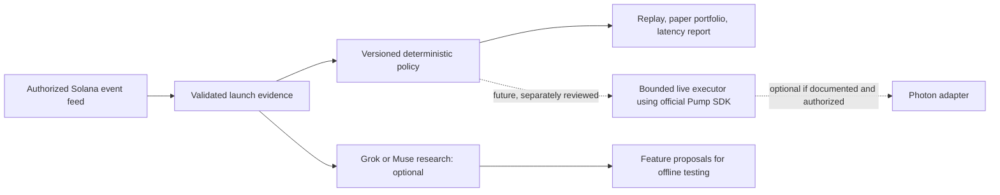

# Pump Launch Sniper

**Can a launch bot be fast, explain every decision, and publish the evidence behind its performance?** This is our open-source attempt to answer that question.

An independent MIT-licensed project by [Positano777](https://github.com/Positano777), built alongside [Memecoin LaunchOps](https://github.com/Positano777/memecoin-launchops). The current release is a **replay and paper-trading prototype**, not a live trading bot. It classifies supplied Pump launch signals as `BUY`, `SKIP`, or `ABSTAIN`, records the policy version and evidence fingerprint, calculates hypothetical 30-minute results after supplied costs, and reports stage-by-stage timing when timestamps exist.

| Available now | Still required for live trading |
|---|---|
| Deterministic, inspectable policy and reason codes | Authorized live Solana launch feed and point-in-time evidence collector |
| Replay accuracy and abstention metrics | Large real chronological cohort with independently checked labels |
| Paper portfolio with fees, slippage, cash and position cap | Verified price/fee data, actual fills and realistic execution study |
| Optional Grok/Muse research explanations | Separately reviewed signer, transaction sender, loss limits and kill switch |
| Latency report for supplied event timestamps | Comparable Photon observations; documented Photon API if integration is offered |

**No real trading, profit, accuracy, or Photon-speed claim is made.** The included three-case dataset and its prices are invented. The thresholds are illustrative. Do not fund the example addresses.

## Run offline

Requires Node 22 or later; no package installation or post-install scripts.

```sh
npm test
npm run replay
npm run paper
npm run latency
```

Replay reads newline-delimited JSON. Each row has a `signal` with only point-in-time information. `outcome.favorableAt30m` is read only by the reporter. `outcome.paperQuote` supplies a hypothetical entry, 30-minute exit, fees, slippage and fixed costs for paper accounting. Those numbers are **not fetched or verified** by this software. Paper output states quote coverage; a partially covered cohort cannot support a strategy-wide PnL claim. [Input format and metric definitions](docs/DATA.md) explain every field.

## Optional Grok or Muse analysis

Set `XAI_API_KEY` for Grok or `MODEL_API_KEY` for Muse in your environment. The tool does **not** load `.env` files. Pass a file with exactly one record:

```sh
node src/cli.mjs analyze one-launch.jsonl grok
node src/cli.mjs analyze one-launch.jsonl muse
```

The adapter sends the public signal to the chosen provider. Never include secrets or private wallet data in a signal. Model text cannot change a policy result. These are hosted API integrations, not forks of either model. Muse Spark Open weights are separately available under Meta's Muse Model License; local hosting is outside this project's budget.

## Toward an independently useful sniper



Photon describes its submission method as proprietary; no documented Photon trading API has been verified. The [release plan](docs/LAUNCH.md) shows what must be proved before a live executor is considered. Do not automate Photon's website or undocumented endpoints.

## Help build it

The most useful contributions are **timestamped, public, reproducible launch evidence**; independent labels for successes and failures; verified fee/quote parsers; and reproducible benchmarks. See [contribution guide](CONTRIBUTING.md), [input format](docs/DATA.md), and [release plan](docs/LAUNCH.md). Please open an issue with a mint, slot, evidence source, observation time and expected result. Do not post wallet keys or private RPC credentials.

## Sources

- [Pump official trade instructions](https://github.com/pump-fun/pump-public-docs/blob/main/docs/instructions/TRADE_V3.md)
- [xAI model API](https://docs.x.ai/developers/rest-api-reference/inference/chat-completions)
- [Meta Model API](https://dev.meta.ai/docs/api-reference)
- [Muse Spark Open](https://dev.meta.ai/docs/muse-spark-open)
- [Photon FAQ](https://pies-organization.gitbook.io/photon-trading/photon-on-sol/faq)

Not affiliated with Pump, Photon, xAI, Meta, or Solana.
