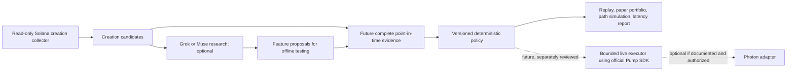

# Pump Launch Sniper

**Can a launch bot be fast, explain every decision, and publish the evidence behind its performance?** This is our open-source attempt to answer that question.

An independent MIT-licensed project by [Positano777](https://github.com/Positano777), built alongside [Memecoin LaunchOps](https://github.com/Positano777/memecoin-launchops). The current release is a **read-only collector, replay and simulation prototype**, not a live trading bot. It records confirmed Pump creation candidates, classifies separately supplied complete launch signals as `BUY`, `SKIP`, or `ABSTAIN`, calculates hypothetical results after supplied costs, and reports stage-by-stage timing when timestamps exist.

| Available now | Still required for live trading |
|---|---|
| Bounded, read-only Pump creation collector | Complete point-in-time launch evidence collector with gap recovery |
| Deterministic, inspectable policy and reason codes | Verified creator, holder, liquidity and quote evidence for those candidates |
| Replay accuracy and abstention metrics | Large real chronological cohort with independently checked labels |
| Paper portfolio with fees, slippage, cash, position, spend and loss caps | Verified price/fee data, actual fills and realistic execution study |
| Path simulation of entry delay, exits and failed entry | Real tick coverage and calibrated failure/landing assumptions |
| RugHawk-family launch evidence adapter with lookahead checks | Independent live verification and complete point-in-time evidence |
| Optional Grok/Muse research explanations | Separately reviewed signer, transaction sender, loss limits and kill switch |
| Latency report for supplied event timestamps | Comparable Photon observations; documented Photon API if integration is offered |

**No real trading, profit, accuracy, or Photon-speed claim is made.** The included three-case dataset and its prices are invented. The thresholds are illustrative. Do not fund the example addresses.

The creation collector uses an authorized RPC provider and emits **candidates, not trade signals**. See its [setup and coverage limits](docs/COLLECTOR.md). A [short public-mainnet smoke test](docs/COLLECTOR-SMOKE.md) found one confirmed creation; completeness and speed have not been benchmarked.

## Run offline

Requires Node 22 or later; no package installation or post-install scripts.

```sh
npm test
npm run replay
npm run paper
npm run latency
npm run simulate
```

Replay reads newline-delimited JSON. Each row has a `signal` with only point-in-time information. `outcome.favorableAt30m` is read only by the reporter. `outcome.paperQuote` supplies a hypothetical entry, 30-minute exit, fees, slippage and fixed costs for paper accounting. Those numbers are **not fetched or verified** by this software. Paper output states quote coverage; a partially covered cohort cannot support a strategy-wide PnL claim. [Input format and metric definitions](docs/DATA.md) explain every field.

`simulate` runs three **illustrative** price-path scenarios: base costs, delayed/stressed entry, and failed entry. It can exit on stop loss, take profit, trailing drop or time limit. Missing price coverage produces an unresolved result, never a made-up profit. On the invented example, the base scenario wins while the stressed scenario loses; neither is market evidence. See the [simulation check](docs/SIMULATION.md) and [input format](docs/DATA.md).

The [RugHawk-family evidence adapter](src/evidence.mjs) accepts our `positano.launch-evidence.v1` export without copying or running the scanner. It imports only covered launch-slot token deltas and rejects evidence scanned after decision time. It does **not** turn same-slot activity into a verified bundle. Try the synthetic example:

```sh
node src/cli.mjs enrich examples/launch.pending.synthetic.jsonl examples/launch-evidence.synthetic.json
```

## Optional Grok or Muse analysis

Set `XAI_API_KEY` for Grok or `MODEL_API_KEY` for Muse in your environment. The tool does **not** load `.env` files. Pass a file with exactly one record:

```sh
node src/cli.mjs analyze one-launch.jsonl grok
node src/cli.mjs analyze one-launch.jsonl muse
```

The adapter sends the public signal to the chosen provider. Never include secrets or private wallet data in a signal. Model text cannot change a policy result. These are hosted API integrations, not forks of either model. Muse Spark Open weights are separately available under Meta's Muse Model License; local hosting is outside this project's budget.

## Toward an independently useful sniper



Photon describes its submission method as proprietary; no documented Photon trading API has been verified. The [source review](SOURCES.md) records upstream reuse decisions and the [release plan](docs/LAUNCH.md) shows what must be proved before a live executor is considered. Do not automate Photon's website or undocumented endpoints.

## Help build it

The most useful contributions are **timestamped, public, reproducible launch evidence**; independent labels for successes and failures; verified fee/quote parsers; and reproducible benchmarks. See [contribution guide](CONTRIBUTING.md), [input format](docs/DATA.md), and [release plan](docs/LAUNCH.md). Please open an issue with a mint, slot, evidence source, observation time and expected result. Do not post wallet keys or private RPC credentials.

## Sources

- [Pump official trade instructions](https://github.com/pump-fun/pump-public-docs/blob/main/docs/instructions/TRADE_V3.md)
- [xAI model API](https://docs.x.ai/developers/rest-api-reference/inference/chat-completions)
- [Meta Model API](https://dev.meta.ai/docs/api-reference)
- [Muse Spark Open](https://dev.meta.ai/docs/muse-spark-open)
- [Photon FAQ](https://pies-organization.gitbook.io/photon-trading/photon-on-sol/faq)

Not affiliated with Pump, Photon, xAI, Meta, or Solana.
